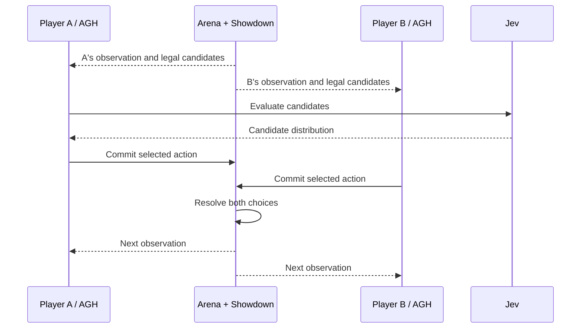

# AGNES Arena

**A Pokémon battle arena for persistent AGH players with Jev-assisted decision making.**

[](demo/arena-match.mp4)

[Full match walkthrough](demo/arena-match.mp4) | [Video player](demo/player.html) | [Running the players](RUNNING.md)

## What the arena does

AGNES Arena connects language-model decisions to a complete turn-based game. Two independent AGH players receive their own observations, evaluate legal candidates through Jev, submit an action and wait for the next decision. Pokémon Showdown resolves the committed actions and declares the winner.

The interesting unit is a whole match. A player must retain context across turns, react to a changed board, handle a forced switch and continue until the match reaches a terminal state. The arena therefore includes session management, decision synchronization, game scheduling and a visual client alongside the move-selection tools.

Jev provides candidate evaluations. The AGH player selects the action. Showdown owns the game rules. Keeping these roles explicit makes it possible to inspect how a decision becomes an actual game event.

## The four packages

| Package | Responsibility | Main engineering concerns |
|---|---|---|
| `agh-battle-plugin` | Give an AGH player the battle tools | Seat identity, observations, legal choices and decision lifecycle |
| `battle-arena` | Own matches and scheduling | Rule-engine integration, simultaneous commitments, queues, cancellation and terminal handling |
| `battle-web` | Present a game in the browser | Battle animations, state updates and player progress |
| `jev-client` | Evaluate candidate decisions | Request handling, response validation, retries, usage and latency information |

This is a Node workspace with a pinned Showdown Client build dependency and a separately installed AGH runtime. The frontend is built from those sources as part of the local workflow.

### A turn, end to end

1. The arena produces a seat-specific observation and the decisions currently available to that seat.
2. The AGH player requests candidate evaluation from Jev.
3. The player selects and commits one action for the current decision.
4. The arena waits for the other seat's commitment.
5. The rule engine resolves the turn and produces public events and updated observations.
6. A new decision begins, including a forced replacement when required by the game.



## Start with the local arena

Requirements: **Node.js 24.10–24.x**. Use pnpm when building your external AGH workspace.

```sh
npm ci
npm run battle:build
npm run battle:serve
```

Open **http://127.0.0.1:8788/**. The serve command builds the animation UI before starting the arena. The default local arena and the live configuration below use separate configurable ports.

### Prepare live players

Prepare an AGH workspace outside this repository with Node.js 24 and pnpm:

```sh
export AGH_SOURCE_DIR=/opt/agnes-harness
(cd "$AGH_SOURCE_DIR" && pnpm install --frozen-lockfile && pnpm --filter @agnes/cli build:local)
python scripts/prepare-agent.py
```

The setup command connects the external CLI and builds the SDK bridge into the ignored `.runtime/` directory. `--check` validates the dependency paths without writing files or starting a player. The pinned Showdown animation client is fetched by `npm run battle:build` as a build dependency.

Create your local configuration:

```sh
cp .env.example .env
```

Fill the model and Jev connection settings before starting the live arena:

| Setting | Used for |
|---|---|
| `AGNES_BASE_URL`, `AGNES_API_KEY`, `AGNES_MODEL` | The primary AGH player model |
| `GATEWAY_BASE_URL`, `GATEWAY_API_KEY` | Additional configured model routes |
| `TYPESAFE_API_KEY` | Jev requests |
| `BATTLE_PORT` | The live arena server |
| `BATTLE_WEB_PORT_A`, `BATTLE_WEB_PORT_B` | Player web instances |
| `BATTLE_CONCURRENCY` | Admission of concurrent matches |

Then run:

```sh
npm run battle:live
```

The provided environment example selects **http://127.0.0.1:18795** for the live arena. Each player receives a project-local AGH configuration. The native player provisioning workflow uses the macOS `script` command; [RUNNING.md](RUNNING.md) describes the workflow and its environment.

`models.example.json` defines model labels, request model IDs and routes. `config/players.example.json` is a second readable example of that configuration format. Local credentials belong in `.env`.

## More than a move-selection wrapper

The implementation addresses the infrastructure needed to run complete matches:

- **Simultaneous decisions.** Both players commit before the rule engine advances the turn.
- **Seat-specific observations.** Each player sees the information exposed to its own seat.
- **Decision identity.** Repeating a submission and changing a submission are handled separately.
- **Forced switches.** Replacement after a knockout and move-triggered switching have their own decision paths.
- **Scheduling.** Multiple games can run concurrently while additional work waits in a bounded queue.
- **Failure and cancellation.** A failed player task releases its job slot and the arena records the game's terminal outcome.
- **Candidate validation.** Jev responses are checked against the candidates for the current decision.
- **Request behavior.** Authentication errors, rate limits, temporary service failures and timeouts are handled by the client.
- **Visual continuity.** The browser presents game animations and updated state throughout the match.

These pieces sit around the actual Showdown rules engine. They are implemented in the four packages rather than hidden in an external match script.

## Tests and development loop

```sh
npm run battle:test
npm run jev:test
```

The battle tests exercise the rules engine, player tools, scheduling and turn handling. The Jev tests exercise the client's response handling using controlled local responses. The source package also exposes `battle:build` for checking the UI independently.

A useful change-review loop is to run the relevant tests, rebuild the UI and inspect a local match. For protocol details, read [battle-protocol.md](docs/battle-protocol.md).

## Repository map

```text
packages/                  four application packages
scripts/                   build, provisioning and player launch tools
tests/                     rules, lifecycle, plugin and scheduling tests
scripts/prepare-agent.py   connection to your external AGH workspace
config/                    player configuration example
demo/                      walkthrough video and preview
```

## Credits


AGH supplies the agent runtime and plugin infrastructure. Jev supplies the candidate-evaluation service. Pokémon Showdown supplies battle rules and client sources. Component licenses and asset attribution are collected in [ACKNOWLEDGEMENTS.md](ACKNOWLEDGEMENTS.md); project licensing is in [LICENSE](LICENSE).
