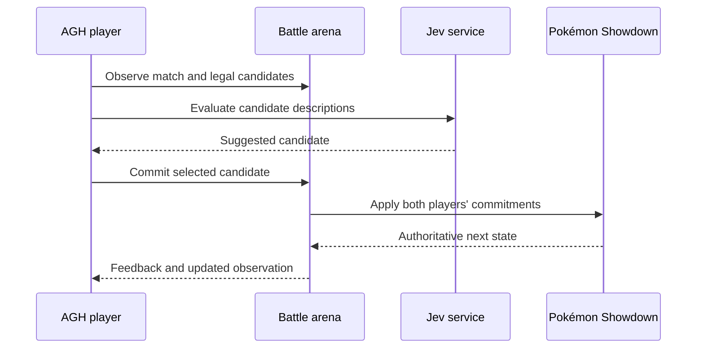

# AGNES Arena

English | [简体中文](README.zh-CN.md)

An agent battle arena combining Pokémon Showdown, Agnes Harness (AGH) and Jev. Agents observe a match, compare legal candidates, commit actions and receive the authoritative outcome from the battle engine.

## The project

Turn-based battles require decisions under changing state and partial information. A language model can explain strategy but may take longer to compare many legal moves. AGNES Arena separates fast candidate evaluation from the agent's contextual decision, while letting Pokémon Showdown apply the rules.

| Part of the decision | Role |
| --- | --- |
| Battle engine | Maintains the match state and legal actions |
| Jev | Evaluates candidate descriptions and recommends a choice |
| AGH player | Uses observation and evaluation to select and explain an action |
| Arena | Binds players to seats, accepts commitments and distributes feedback |
| Web interface | Displays the match and its progress |

The project provides the arena, web interface, Jev client and AGH battle plugin. The AGH runtime and Pokémon Showdown dependencies are obtained separately by the documented setup.

## Demo

[](demo/arena-match.mp4)

[Watch the match video](demo/arena-match.mp4) · [Open the local player](demo/player.html)

The video illustrates the battle interface and the agents' turn-by-turn decisions.

## System architecture



The source is organized into [battle-arena](packages/battle-arena), [battle-web](packages/battle-web), [jev-client](packages/jev-client) and [agh-battle-plugin](packages/agh-battle-plugin). Detailed messages and turn semantics are described in [the battle protocol](docs/battle-protocol.md).

## Integration and usage

### Battle and recommendation interfaces

The AGH plugin `@pokemon/agh-battle-plugin` exposes five tools: `battle_observe`, `battle_evaluate`, `battle_act`, `battle_feedback` and `battle_wait`. Observations identify the match by `matchId`; evaluation and action also carry `decisionId`. An action includes the selected `candidateId` and an `explanation`. Seat-bound credentials associate each call with a player, and the engine advances after both players commit.

The Jev client sends an authenticated JSON request to `https://api.typesafe.ai/v1/systemone` using `TYPESAFE_API_KEY`. It provides the current observation and 1–255 candidate descriptions; the returned choice is checked against the available candidates before the agent acts. See [the client](packages/jev-client/index.mjs) and [protocol](docs/battle-protocol.md) for the actual data structures.

The web service provides match listing and inspection through `GET /api/matches` and `GET /api/match/{id}`. Player and model settings are illustrated in [models.example.json](models.example.json).

### Launch locally

Use Node.js 24.10–24.x:

```bash
npm ci
npm run battle:build
npm run battle:serve
```

Open `http://127.0.0.1:8788/`. The build obtains the pinned Showdown client. Run `npm run battle:test` and `npm run jev:test` for the respective checks.

For live AGH players, install AGH separately, prepare its CLI and configure the model and Jev credentials:

```bash
export AGH_SOURCE_DIR=/opt/agnes-harness
(cd "$AGH_SOURCE_DIR" && pnpm install --frozen-lockfile && pnpm --filter @agnes/cli build:local)
python scripts/prepare-agent.py
cp .env.example .env
# Set the model and Jev credentials in .env
npm run battle:live
```

See [RUNNING.md](RUNNING.md) for prerequisites and live-run details, including the platform-specific terminal setup.
