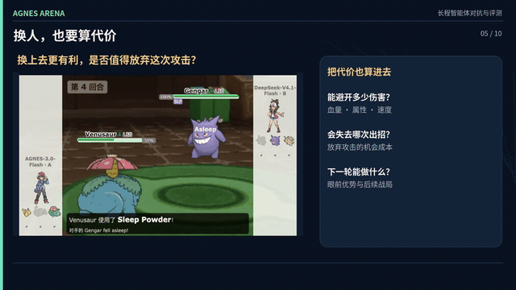
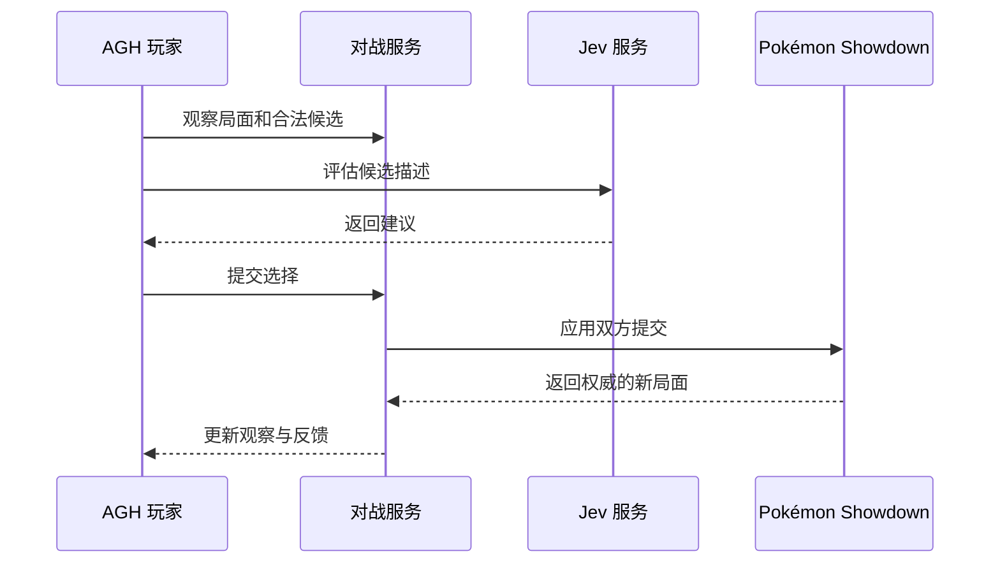

# AGNES Arena 宝可梦智能对战

[English](README.md) | 简体中文

将宝可梦对战引擎、Agnes Harness（AGH）与 Jev 连接起来，让智能体观察局面、比较合法行动、提交选择并接收对战反馈。

## 项目介绍

回合制对战需要在局势变化和信息不完全的情况下持续决策。大语言模型可以结合上下文解释策略，但逐项比较大量候选行动可能较慢。本项目将候选评估和智能体决策分工，由 Pokémon Showdown 根据规则推进对局。

| 环节 | 职责 |
| --- | --- |
| 对战引擎 | 维护局面和合法动作 |
| Jev | 评估候选动作描述并给出建议 |
| AGH 玩家 | 综合观察与评估选择动作并解释 |
| 对战服务 | 管理座位、接收双方提交并返回反馈 |
| 网页界面 | 展示对局与过程 |

仓库包含对战服务、前端、Jev 客户端及 AGH 对战插件；AGH 运行时和 Pokémon Showdown 依赖按安装说明单独准备。

## 演示视频

[](demo/arena-match.mp4)

[观看完整对战视频](demo/arena-match.mp4) · [打开本地播放页](demo/player.html)

视频展示对战界面及智能体逐回合决策过程。

## 架构与流程



源码分别位于 [battle-arena](packages/battle-arena)、[battle-web](packages/battle-web)、[jev-client](packages/jev-client) 和 [agh-battle-plugin](packages/agh-battle-plugin)。消息格式与回合规则见 [对战协议](docs/battle-protocol.md)。

## 集成标准与使用

### 对战工具与候选评估

AGH 插件 `@pokemon/agh-battle-plugin` 提供 `battle_observe`、`battle_evaluate`、`battle_act`、`battle_feedback`、`battle_wait` 五个工具。观察通过 `matchId` 指定对局；评估与动作还携带 `decisionId`；动作提交包含 `candidateId` 和 `explanation`。调用凭据与玩家座位绑定，双方提交后引擎推进回合。

Jev 客户端使用 `TYPESAFE_API_KEY` 向 `https://api.typesafe.ai/v1/systemone` 发送认证 JSON 请求，包含当前观察和 1–255 条候选描述。返回结果会与可用候选核对，再供智能体选择。具体字段见 [客户端源码](packages/jev-client/index.mjs) 和 [对战协议](docs/battle-protocol.md)。

网页服务提供 `GET /api/matches` 和 `GET /api/match/{id}` 查询。玩家与模型配置示例见 [models.example.json](models.example.json)。

### 启动

使用 Node.js 24.10–24.x：

```bash
npm ci
npm run battle:build
npm run battle:serve
```

访问 `http://127.0.0.1:8788/`。构建步骤会获取固定版本的 Showdown 客户端。可分别通过 `npm run battle:test`、`npm run jev:test` 运行检查。

连接 AGH 玩家时，先单独安装 AGH 并准备 CLI，再配置模型和 Jev 凭据：

```bash
export AGH_SOURCE_DIR=/opt/agnes-harness
(cd "$AGH_SOURCE_DIR" && pnpm install --frozen-lockfile && pnpm --filter @agnes/cli build:local)
python scripts/prepare-agent.py
cp .env.example .env
# 在 .env 中配置模型和 Jev 凭据
npm run battle:live
```

详细依赖、平台相关的终端配置和实战步骤见 [RUNNING.md](RUNNING.md)。
