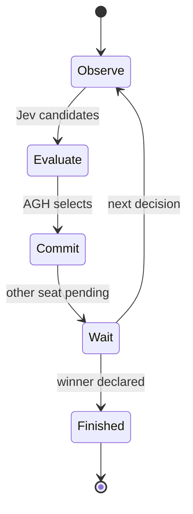

# Battle protocol

## Three roles

The arena combines two persistent AGH players, a Jev decision client and the Pokémon Showdown rules engine.

A player receives its current observation and legal candidates, consults Jev and commits one choice. The arena waits for both seats before advancing the turn. A forced switch is handled as its own decision.

## Decision lifecycle

`packages/battle-arena/` owns game state and scheduling. `packages/jev-client/` owns request handling and candidate validation. The UI is built from the included Showdown Client source, and each AGH player has a project-local runtime home.

The public test commands exercise simultaneous decisions, idempotent submissions, forced switches, queue admission and terminal handling with the actual rules engine.
